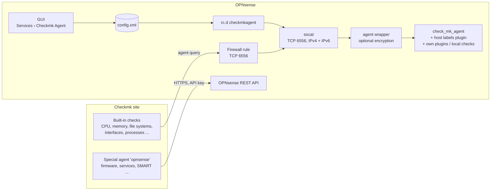
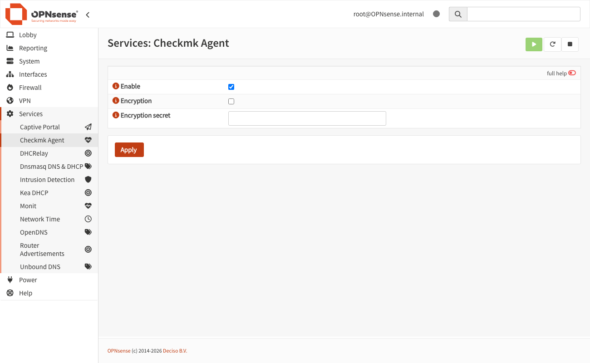
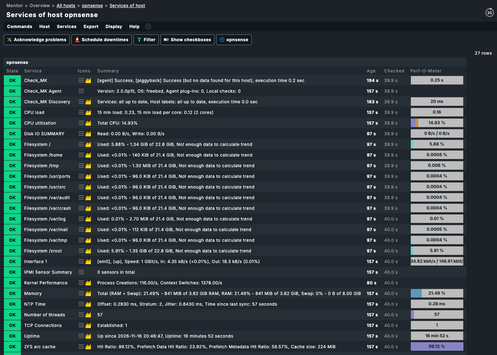
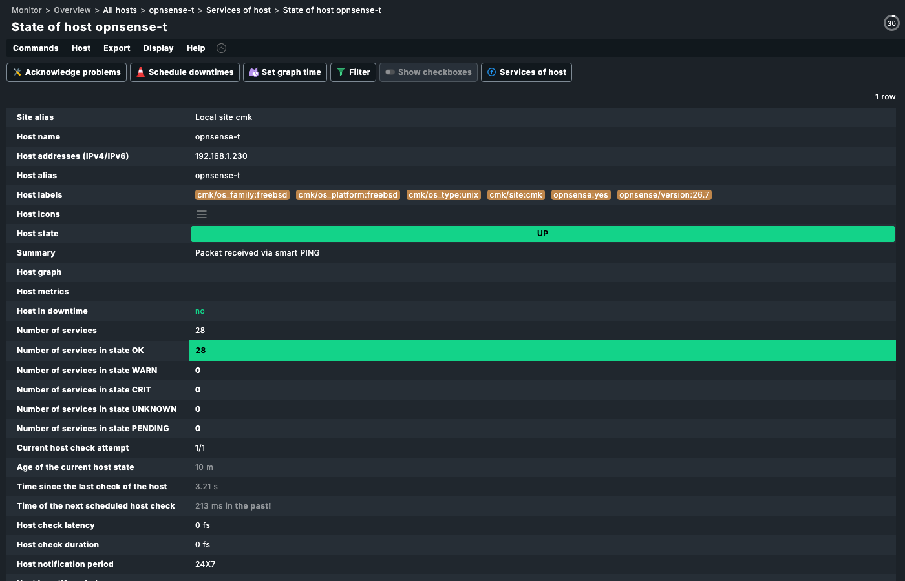

# Checkmk agent for OPNsense (os-checkmk-agent)

An OPNsense plugin that runs the Checkmk agent on the firewall. A Checkmk server
then monitors OPNsense like any other host, and Checkmk's built-in checks
evaluate the data: CPU, memory, file systems and ZFS, network interfaces,
processes, uptime, NTP and more.

The plugin is a switch in the OPNsense GUI around two packages from the OPNsense
repository: `check_mk_agent` (the Checkmk agent for FreeBSD) and `socat` (makes
it reachable on TCP port 6556). It adds optional symmetric encryption and host
labels that mark the host as OPNsense.

> Status: in development, planned as a pull request to
> [opnsense/plugins](https://github.com/opnsense/plugins). Not yet available in
> the OPNsense plugin list.

## Contents

- [Overview](#overview)
- [Screenshots](#screenshots)
- [Tested with](#tested-with)
- [Setup](#setup)
- [Manual installation](#manual-installation)
- [Encryption](#encryption)
- [Host labels](#host-labels)
- [Query over SSH](#query-over-ssh)
- [Own agent plugins and local checks](#own-agent-plugins-and-local-checks)
- [Updates](#updates)
- [OPNsense data from the REST API](#opnsense-data-from-the-rest-api)
- [Uninstalling](#uninstalling)
- [Building from source](#building-from-source)
- [Feedback](#feedback)
- [License](#license)
- [Disclaimer](#disclaimer)

## Overview



## Screenshots

Settings page under *Services › Checkmk Agent*:



The firewall as a host in a fresh Checkmk 2.5 site, with only the services the
agent provides:



Host labels set by the plugin, next to Checkmk's own labels:



## Tested with

| Component | Version | Result |
|---|---|---|
| OPNsense 26.7 | 26.7 (FreeBSD 15.1), `check_mk_agent` 2.5.0p15, `socat` 1.8.1.3 | install, enable/disable, reboot, upgrade, uninstall, encryption, SSH: OK (2026-11-14) |
| OPNsense 26.1 | 26.1.11_10 (FreeBSD 14.3), `check_mk_agent` 2.4.0p20, `socat` 1.8.1.1 | manual installation from the release, agent queried by Checkmk 2.5.0p19: OK (2026-11-14, long-term test running) |
| Checkmk 2.4 | `checkmk/check-mk-cloud:2.4.0p40` | discovery (26 services), decryption: OK (2026-11-14) |
| Checkmk 2.5 | 2.5.0p19 Ultimate | 36 services OK in production monitoring, decryption, host labels: OK (2026-11-14) |
| Checkmk 3.0 | `checkmk/check-mk-ultimate:3.0.0-2026.11.14` (daily) | discovery (26 services), decryption: OK (2026-11-14) |

## Setup

1. Install the plugin under *System › Firmware › Plugins* (`os-checkmk-agent`).
   `check_mk_agent` and `socat` are installed with it. As long as the plugin is
   not in the official list, see [Manual installation](#manual-installation).
2. *Services › Checkmk Agent*: check **Enable** and click **Apply**.
3. *Firewall › Rules*, on the interface the Checkmk server comes from: allow
   TCP to port 6556 on *This Firewall*, with the Checkmk server as source.
4. In Checkmk, add the firewall as a host with "Checkmk agent (Server)" and run
   the service discovery.

The plugin never opens the port itself. Who may query the agent is decided only
by the firewall rule, so restrict the source to your Checkmk server.

## Manual installation

Until the plugin is in the official plugin list, install it from the
[releases](https://gitlab.thatsallmine.de/checkmk1/opnsense_checkmk_agent/-/releases).
Pick the package for your OPNsense version (26.1 or 26.7) and run as root on the
firewall (console or SSH, option 8 "Shell"):

```sh
# dependencies from the OPNsense repository
pkg install -y check_mk_agent socat

# the plugin (example: 1.0-rc3 for OPNsense 26.7)
fetch -o /tmp/os-checkmk-agent.pkg https://gitlab.thatsallmine.de/api/v4/projects/76/packages/generic/os-checkmk-agent/1.0-rc3/os-checkmk-agent-1.0-opnsense26.7.pkg
sha256 /tmp/os-checkmk-agent.pkg      # compare with SHA256SUMS of the release
pkg add /tmp/os-checkmk-agent.pkg
rm /tmp/os-checkmk-agent.pkg

# register it, so the firmware page lists it as an installed plugin
/usr/local/opnsense/scripts/firmware/register.php install os-checkmk-agent
```

Then continue with step 2 of [Setup](#setup). To install a newer build of the
same version, use `pkg add -f`. To remove it, use
`pkg delete os-checkmk-agent` or the firmware page.

The firmware page shows the plugin as *orphaned*, because it does not come from
the OPNsense repository, and has no plugin details. That is expected.

If another Checkmk agent already listens on port 6556 (for example a manually
installed one), stop and disable it first; only one program can use the port.

## Encryption

The FreeBSD agent sends plain text. The plugin can encrypt its output with a
shared secret, in the same format as Checkmk's Linux agent (`05`: PBKDF2-SHA256
with 600000 iterations, AES-256-CBC, HMAC-SHA256).

1. In Checkmk, create the rule *Symmetric encryption (Linux, Windows)* for the
   firewall host and enter a secret.
2. On OPNsense, under *Services › Checkmk Agent*: check **Encryption**, enter the
   same secret, click **Apply**.

How the secret is handled:

- It is stored in `config.xml` like other secrets of OPNsense and its plugins,
  and therefore also in configuration backups. Keep those backups safe.
- The GUI and the API never show it again. Leave the field empty to keep the
  current secret.
- On the firewall it is written to `/usr/local/etc/checkmkagent/secret`, readable
  by root only (directory `0700`, file `0600`). It is passed to `openssl` through
  a file descriptor, never on a command line.

## Host labels

The plugin adds a small agent plugin that sends two host labels:

```
opnsense:yes
opnsense/version:26.7
```

Checkmk shows them on the host after the service discovery. Use them in rule
conditions to target all OPNsense firewalls, or one OPNsense version. The agent
itself still reports `AgentOS: freebsd`, so rules for FreeBSD hosts keep
applying.

## Query over SSH

Instead of TCP port 6556, Checkmk can also run the agent over SSH. This needs no
setting in the plugin; OPNsense's own user management does it:

1. *System › Access › Users*: create a user, e.g. `checkmk`, member of the group
   `admins`, login shell `/bin/sh`, with *Generate a scrambled password*.
   OPNsense allows SSH only for members of `admins` (wheel). Membership in
   `admins` also grants GUI rights, but without a known password the user cannot
   log in to the GUI.
2. In the field *Authorized keys* of that user, enter the public key of the
   Checkmk site, restricted to the agent:

   ```
   command="/usr/local/bin/check_mk_agent",no-port-forwarding,no-X11-forwarding,no-agent-forwarding,no-pty ssh-ed25519 AAAA... checkmk
   ```

3. *System › Settings › Administration*: enable Secure Shell.
4. In Checkmk, use the rule *Individual program call instead of agent access*
   with `ssh -T -oStrictHostKeyChecking=accept-new checkmk@$HOSTADDRESS$`.

OPNsense writes the key from `config.xml`, so it survives updates and reboots.
Thanks to `command=`, the key runs only the agent: any other command still
returns the agent output, and port forwarding is refused (tested on 26.7). The
agent then runs as the user `checkmk` instead of root and delivers the same
sections.
Over SSH the transport is encrypted by SSH itself, so point `command=` to
`/usr/local/bin/check_mk_agent` as shown. The *Encryption* setting of the plugin
applies to port 6556 only; Checkmk reads the plain SSH output even with an
encryption rule for the host (tested with 2.5.0p19). Enable the plugin's agent service only if
you also want port 6556.

## Own agent plugins and local checks

The plugin ships three small agent plugins, evaluated by Checkmk's built-in
checks: host labels, *SSH daemon configuration* (`sshd -T` of OPNsense's SSH
daemon) and *Logins* (number of logged-in users). To leave out a service you do
not need, disable it in Checkmk (rule *Disabled services*, or on the service
discovery page) – centrally for all firewalls, no setting on OPNsense needed.

The agent runs executable files from:

- `/usr/local/lib/check_mk_agent/plugins/` (agent plugins)
- `/usr/local/lib/check_mk_agent/local/` (local checks)

OPNsense firmware updates and plugin updates leave your own files there alone.
They are not part of `config.xml`, though: after a fresh install of the firewall,
copy them back from your own backup. The host labels plugin belongs to this
package and comes back automatically when the plugin is installed.

## Updates

- **The plugin** is updated with OPNsense, like every other plugin.
- **The agent** comes from the FreeBSD port
  [`net-mgmt/check_mk_agent`](https://www.freshports.org/net-mgmt/check_mk_agent/).
  OPNsense builds it into its package repository, so a new agent version arrives
  with a regular OPNsense update. The plugin does not pin a version.
- Checkmk servers read the data of agents from neighbouring versions, so the
  agent version does not have to match the Checkmk version exactly
  (see the [tested versions](#tested-with)).

## OPNsense data from the REST API

This plugin delivers the operating system view through the agent. For
OPNsense-specific data, use the Checkmk special agent
[**opnsense**](https://github.com/Gulaschcowboy/checkmk_extensions/tree/main/opnsense),
which queries the OPNsense REST API. Both work side by side on the same host.
Wishes for data from the REST API belong there. A wider comparison, including
SNMP and the Bashclub agent, is in [docs/COMPARISON.md](docs/COMPARISON.md).

| Data | This plugin (agent) | Special agent "opnsense" (✔ today, ➕ possible via API) |
|---|---|---|
| CPU load and utilization | ✔ | ✔ load average (overlap) |
| Memory and swap | ✔ | ✔ (overlap) |
| File systems, ZFS, zpool | ✔ | ✔ file systems (overlap) |
| Uptime | ✔ | ✔ (overlap) |
| Network interfaces (traffic, errors) | ✔ | ➕ `interfaces/overview`, `diagnostics/interface` |
| Processes, threads, TCP connections, kernel counters | ✔ | – |
| NTP | ✔ | ➕ `ntpd/service` |
| SSH daemon configuration, logins | ✔ | – |
| Host labels, own agent plugins and local checks | ✔ | – |
| Firmware version, pending updates | – | ✔ `core/firmware/status` |
| OPNsense services | – | ✔ `core/service/search` |
| SMART (with os-smart) | – | ✔ `smart/service` |
| Temperatures | – | ✔ queried (`diagnostics/system/system_temperature`) |
| Gateways (latency, loss) | – | ➕ `routes/gateway/status` |
| CARP / high availability | – | ➕ `diagnostics/interface/carpStatus`, `getVipStatus` |
| VPN: IPsec, OpenVPN, WireGuard | – | ➕ `ipsec/sessions`, `openvpn/service/searchSessions`, `wireguard/service/show` |
| DNS resolver statistics (Unbound) | – | ➕ `unbound/diagnostics/stats` |
| DHCP leases (Kea, Dnsmasq) | – | ➕ `kea/leases4`, `dnsmasq/leases/search` |
| Certificate expiry | – | ➕ `trust/cert/search` |
| Firewall states and pf statistics | – | ➕ `diagnostics/firewall/pfStatistics` |
| IDS alerts | – | ➕ `ids/service/queryAlerts` |

The ➕ endpoints exist in OPNsense 26.7; they are ideas for the special agent,
not part of it today.

## Uninstalling

Remove the plugin under *System › Firmware › Plugins*. The agent is stopped and
the stored secret file is deleted. Remove the firewall rule for port 6556 as
well.

## Building from source

The plugin lives in `net-mgmt/checkmk-agent/` (a copy of the branch in the
`opnsense/plugins` fork). See [docs/DEVELOPMENT.md](docs/DEVELOPMENT.md) for
building, testing and the upstream workflow.

## Feedback

Questions, suggestions and test reports are welcome:

- in the [Checkmk forum](https://forum.checkmk.com/) – send me (Doc) a direct
  message
- as an **issue or pull request on GitHub**:
  [doctore74/opnsense_checkmk_agent](https://github.com/doctore74/opnsense_checkmk_agent)

The project itself lives on gitlab.thatsallmine.de, which has no public sign-up;
GitHub and gitlab.com are read-only mirrors of it. Pull requests on GitHub are
taken over into the project and then appear as merged on GitHub.

## License

BSD-2-Clause, like OPNsense and its plugins. See [LICENSE](LICENSE).

## Disclaimer

I did not develop this plugin officially as an employee of Checkmk GmbH, but rather as a private individual.
